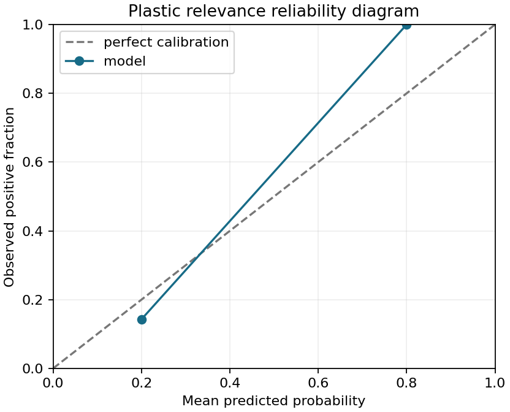

# Evaluation report: dummy-v1

- Split: `dev` (12 works)
- Data snapshot: `synthetic-fixture-v1`

## Per-class results

| Label | Class | Precision | Recall | F1 | Support |
|---|---|---:|---:|---:|---:|
| plastic_related | false | 0.857 | 1.000 | 0.923 | 6 |
| plastic_related | true | 1.000 | 0.833 | 0.909 | 6 |
| plastic_tier | core | 1.000 | 0.833 | 0.909 | 6 |
| plastic_tier | chemicals-in-plastics | undefined | undefined | undefined | 0 |
| plastic_tier | none | 0.857 | 1.000 | 0.923 | 6 |
| ca_sampled | yes | 1.000 | 1.000 | 1.000 | 6 |
| ca_sampled | partial | undefined | undefined | undefined | 0 |
| ca_sampled | no | 1.000 | 1.000 | 1.000 | 6 |
| ca_sampled | unclear | undefined | undefined | undefined | 0 |
| study_type | field | 1.000 | 1.000 | 1.000 | 6 |
| study_type | review | 1.000 | 1.000 | 1.000 | 6 |

## Domain tag results

| Tag | Precision | Recall | F1 | Support | Status |
|---|---:|---:|---:|---:|---|
| occurrence_and_monitoring | 1.000 | 0.833 | 0.909 | 6 | meets target |
| analytical_methods | undefined | undefined | undefined | 0 | insufficient positive support |
| fate_transport_and_sorption | undefined | undefined | undefined | 0 | insufficient positive support |
| wastewater_and_treatment | undefined | undefined | undefined | 0 | insufficient positive support |
| ecotoxicology_and_trophic_transfer | undefined | undefined | undefined | 0 | insufficient positive support |
| soil_and_agriculture | undefined | undefined | undefined | 0 | insufficient positive support |
| human_exposure_and_health_risk | undefined | undefined | undefined | 0 | insufficient positive support |
| air | undefined | undefined | undefined | 0 | insufficient positive support |

## Calibration

| Mean probability | Observed rate | Count |
|---:|---:|---:|
| 0.200 | 0.143 | 7 |
| 0.800 | 1.000 | 5 |

## Error analysis

| Work ID | Mismatched labels | Domain false positives | Domain false negatives |
|---|---|---|---|
| synthetic:000 | plastic_related, plastic_tier | - | - |
| synthetic:002 | - | - | occurrence_and_monitoring |

## Thresholds and interpretation

G-9 / spec F1 targets: `ca_sampled=yes` precision >=0.85 and recall >=0.80; plastic relevance F1 >=0.90; domain-tag F1 <0.70 is experimental; gazetteer gate recall >=0.95. The gate target is not computed unless gate predictions are supplied.

Metrics describe the supplied split only. Synthetic metrics are not corpus performance. Test results are final-only and must not guide development.

This harness reports metrics; it does not tune thresholds. Use dev for development and reserve test for a final, frozen evaluation. Gold rows must be canonical, adjudicated, and one row per work. Undefined metrics remain explicit.
